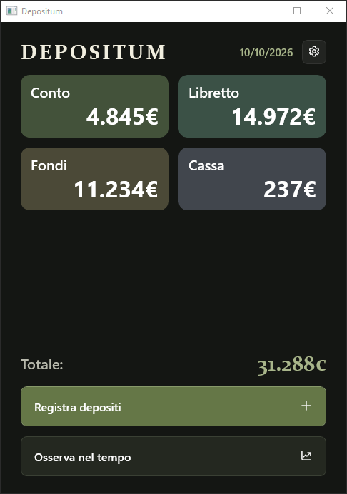
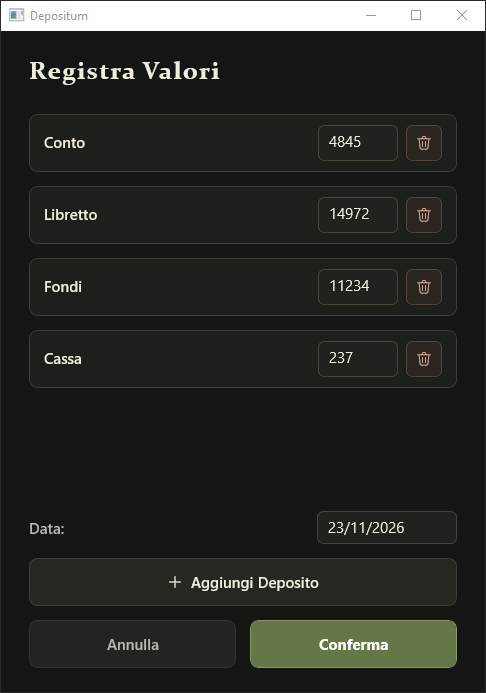
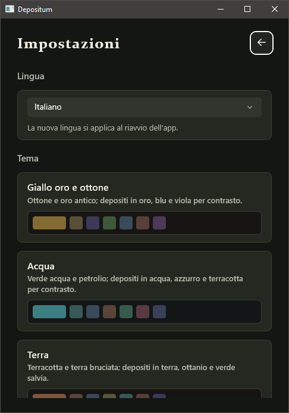
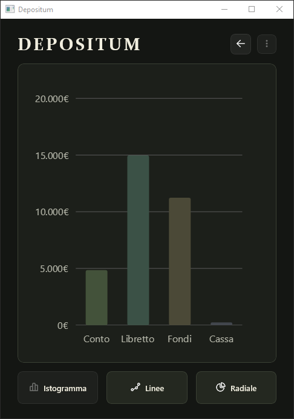
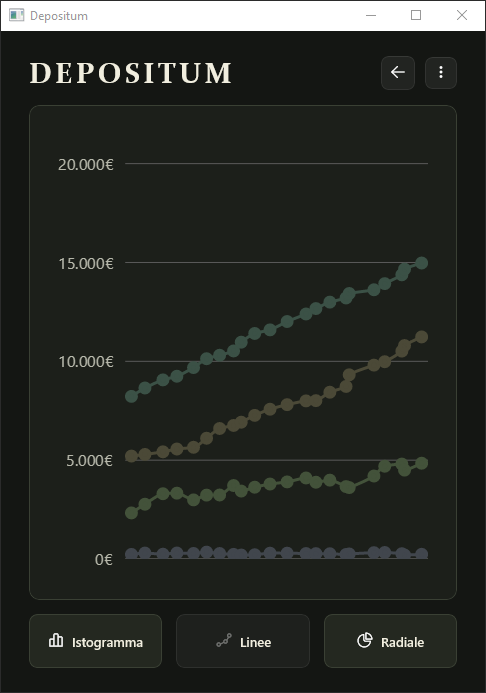
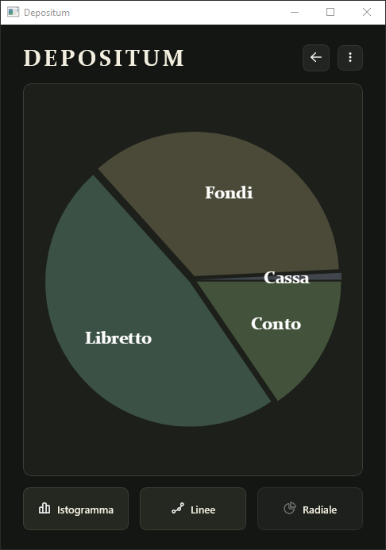
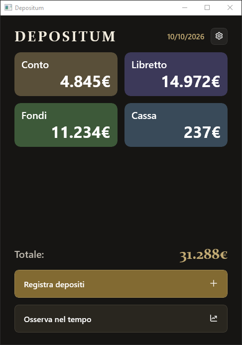
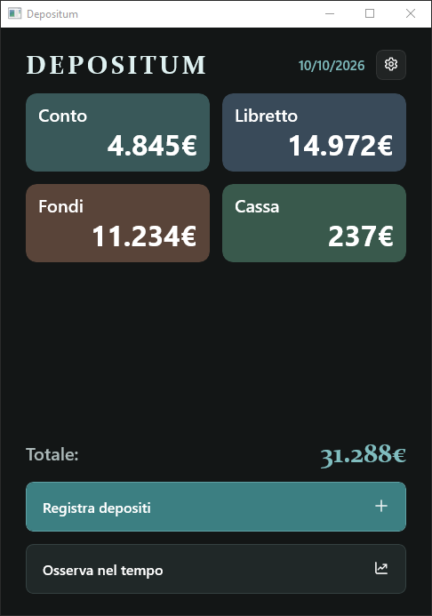
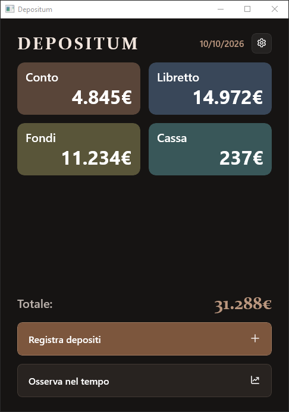
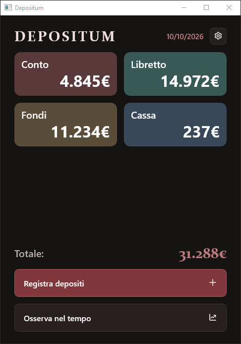

<div align="center">

# Depositum

**Tieni traccia dei tuoi risparmi, deposito per deposito, nel tempo.**

Un'app nativa per Windows con il peso di una calcolatrice: la apri, registri i saldi, guardi come cambiano, la chiudi.


[English](README.md) · **Italiano**



</div>

---

**Indice** · [Perché Depositum](#perché-depositum) · [Funzioni](#funzioni) · [Installazione](#installazione) · [Aggiornare e disinstallare](#aggiornare-e-disinstallare) · [Privacy e dati](#privacy-e-dati) · [Compilare dal codice](#compilare-dal-codice)

## Perché Depositum

- **Nativa Windows, leggera per scelta.** Scritta con WinUI 3 e .NET 8: nessun browser incorporato, nessun servizio in background, nessun account, nessuna pubblicità. Un unico pacchetto di circa 30 MB che si apre in un attimo, come le utility di sistema.
- **I dati restano sul tuo PC.** L'app non si collega mai a internet. Le rilevazioni sono salvate in un unico file cifrato, che solo il tuo utente Windows può leggere, sul tuo computer.
- **Semplice di proposito.** Un deposito è un nome e un importo; una rilevazione è una data con gli importi di tutti i depositi. L'app fa questo, e lo fa bene.

## Funzioni

| Dashboard | Registra valori | Impostazioni |
|:---:|:---:|:---:|
|  |  |  |
| L'ultimo saldo di ogni deposito e il totale. | Aggiorni gli importi, aggiungi o togli depositi, scegli la data. | Lingua e tema. |

### Grafici

| Istogramma | Linee | Radiale |
|:---:|:---:|:---:|
|  |  |  |
| I depositi a confronto, all'ultima rilevazione. | Come è cambiato ogni deposito, rilevazione dopo rilevazione. | Come si divide il totale. |

### Temi

Cinque palette di colori, da scegliere nelle impostazioni.

| Verde natura | Giallo oro e ottone | Acqua | Terra | Rosso |
|:---:|:---:|:---:|:---:|:---:|
|  |  |  |  |  |

### Lingue

Italiano e inglese. Di base l'app segue la lingua di Windows (inglese per le lingue diverse dall'italiano); si può scegliere nelle impostazioni.

<sub>Tutti gli screenshot usano dati inventati.</sub>

## Installazione

**Requisiti:** Windows 10 versione 1809 o successiva, oppure Windows 11, su PC a 64 bit (x64). Non serve installare altro: .NET è incluso nel pacchetto.

### 1. Scarica

Dall'[ultima release](../../releases/latest) scarica entrambi i file:

- `Depositum_x.y.z.0_x64.msix` – l'app
- `Depositum.cer` – il certificato con cui è firmata

### 2. Rendi attendibile il certificato (solo la prima volta)

Windows installa solo app firmate. Depositum è firmata con un certificato dell'autore, non acquistato da un'autorità di certificazione, quindi una volta bisogna dire a Windows che può fidarsi.

1. Doppio clic su `Depositum.cer` e scegli **Installa certificato**.
2. Seleziona **Computer locale** e conferma la richiesta di amministratore.
3. Seleziona **Colloca tutti i certificati nel seguente archivio** → **Sfoglia** → **Persone attendibili** → **OK**.
4. **Avanti** → **Fine**.

<details>
<summary>Preferisci la riga di comando?</summary>

Da PowerShell **come amministratore**, nella cartella in cui hai scaricato il file:

```powershell
Import-Certificate -FilePath .\Depositum.cer -CertStoreLocation Cert:\LocalMachine\TrustedPeople
```
</details>

### 3. Installa

Doppio clic sul file `.msix` e scegli **Installa**. Depositum compare nel menu Start.

<details>
<summary>Se qualcosa non va</summary>

- **"App non attendibile" o errore sul certificato** – il passo 2 è stato saltato o il certificato è finito in un altro archivio: ripetilo, scegliendo *Computer locale* e *Persone attendibili*.
- **Manca Microsoft.WindowsAppRuntime** – installa il runtime di Windows App SDK dalla [pagina ufficiale di download](https://learn.microsoft.com/windows/apps/windows-app-sdk/downloads), poi ripeti il passo 3.
</details>

## Aggiornare e disinstallare

- **Aggiornare:** scarica il nuovo `.msix` e aprilo. I dati restano. Il certificato non va reso attendibile di nuovo.
- **Disinstallare:** Start → clic destro su Depositum → **Disinstalla**. ⚠️ **Così si cancellano anche i dati.**

## Privacy e dati

- Depositum non usa la rete: niente telemetria, niente aggiornamenti in background, niente cloud.
- Le rilevazioni sono salvate in `history.dpstm`, nella cartella privata dell'app per il tuo utente Windows.
- Il file è cifrato con la protezione dati di Windows (DPAPI): lo può leggere solo il tuo account Windows su questo PC. Copiato altrove, o aperto da un altro utente, è illeggibile.

## Compilare dal codice

**Requisiti:** Windows, l'[SDK di .NET 8](https://dotnet.microsoft.com/download/dotnet/8.0) e, per lavorare in un IDE, Visual Studio 2022 con il carico di lavoro *Sviluppo di applicazioni WinUI*.

```powershell
dotnet build src/Depositum/Depositum.csproj -p:Platform=x64
dotnet test tests/Depositum.Tests
```

| Cartella | Contenuto |
|---|---|
| `src/Depositum` | L'app WinUI 3: pagine, dialoghi, servizi, temi, testi. |
| `src/Depositum.Core` | Logica senza interfaccia (rilevazioni, formati, struttura del file, palette), coperta da test. |
| `tests/Depositum.Tests` | Test xUnit di `Depositum.Core`. |
| `docs` | Note sul progetto, screenshot e la [procedura di rilascio](docs/rilascio.md). |

Per provare l'app con dati inventati senza toccare i propri, impostare la variabile d'ambiente `DEPOSITUM_CARTELLA_DATI` su un'altra cartella prima di avviare una build non pacchettizzata.
