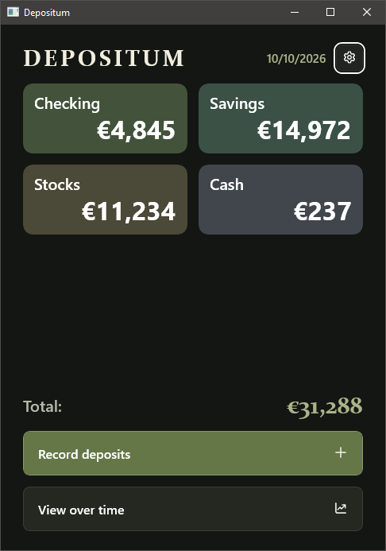
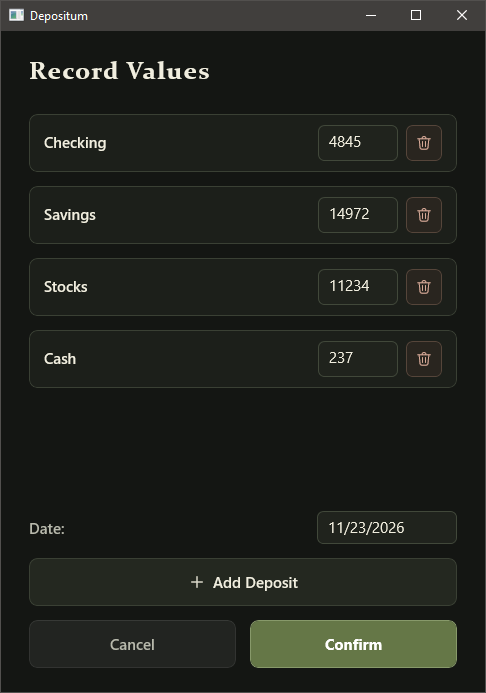
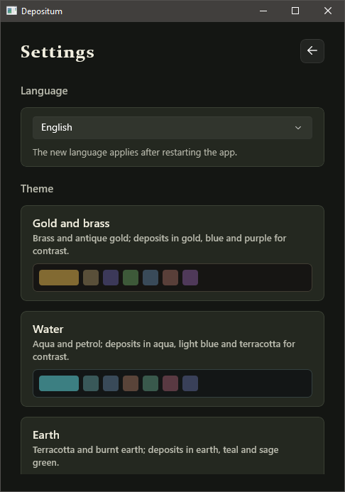
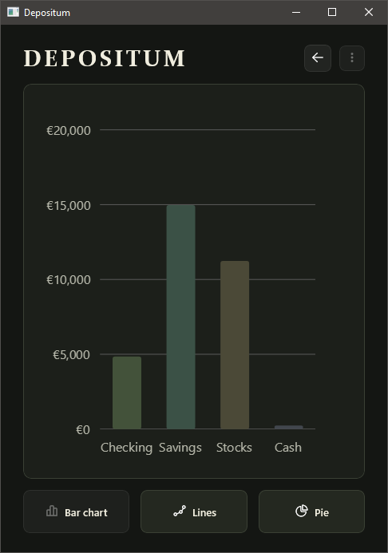
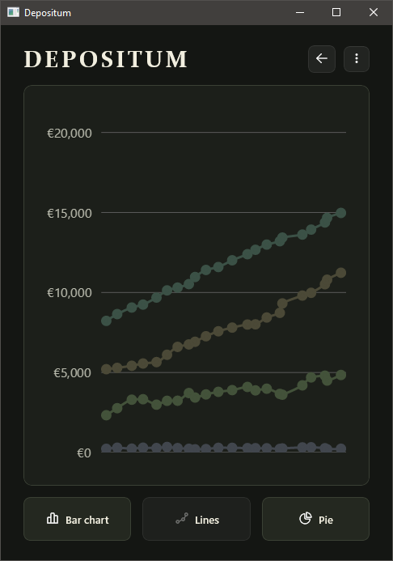
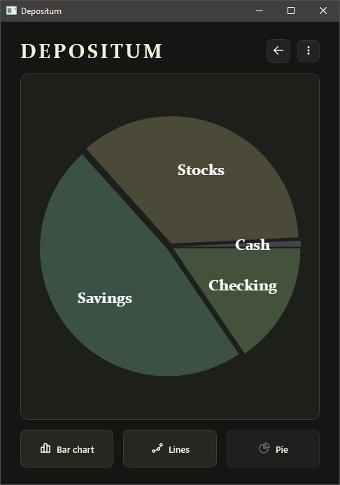
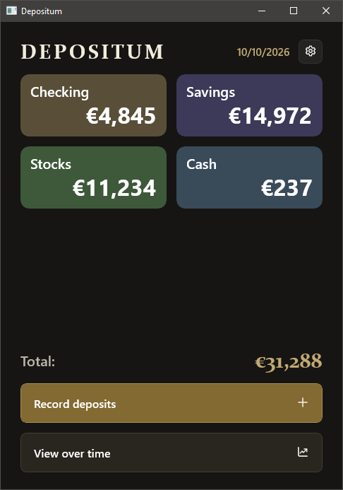
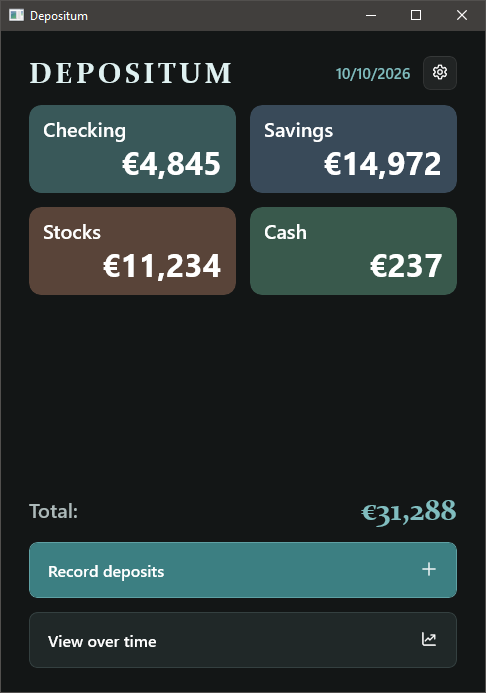
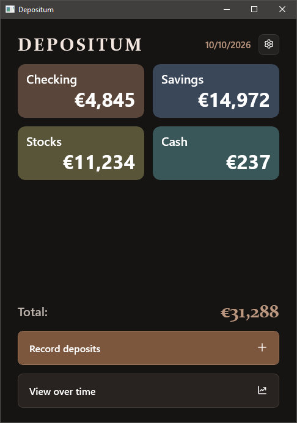
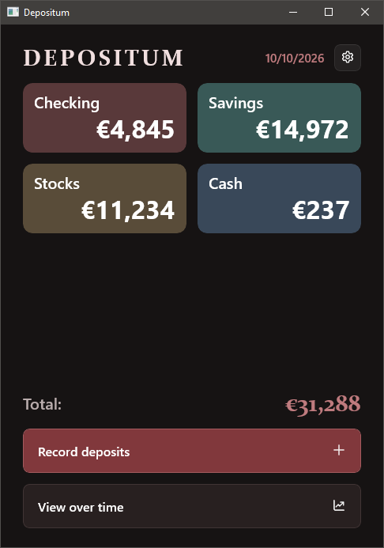

<div align="center">

# Depositum

**Keep track of your savings, deposit by deposit, over time.**

A native Windows app with the weight of a calculator: open it, record your balances, see how they change, close it.


**English** · [Italiano](README.it.md)



</div>

---

**Contents** · [Why Depositum](#why-depositum) · [Features](#features) · [Installation](#installation) · [Updating and uninstalling](#updating-and-uninstalling) · [Privacy and data](#privacy-and-data) · [Building from source](#building-from-source)

## Why Depositum

- **Native Windows, light by design.** Built with WinUI 3 and .NET 8: no embedded browser, no background services, no account, no ads. A single package of about 30 MB that opens in a moment, like the system's own utilities.
- **Your data stays on your PC.** The app never connects to the internet. Entries are saved in a single encrypted file, readable only by your Windows user on your computer.
- **Simple on purpose.** A deposit is a name and an amount; an entry is a date with the amounts of all your deposits. The app does just that, and does it well.

## Features

| Dashboard | Record values | Settings |
|:---:|:---:|:---:|
|  |  |  |
| The latest balance of every deposit and the total. | Update the amounts, add or remove deposits, choose the date. | Language and theme. |

### Charts

| Bar chart | Lines | Pie |
|:---:|:---:|:---:|
|  |  |  |
| Deposits side by side, at the latest entry. | How each deposit changed, entry after entry. | How the total is split. |

### Themes

Five color palettes, chosen in the settings.

| Nature green | Gold and brass | Water | Earth | Red |
|:---:|:---:|:---:|:---:|:---:|
|  |  |  |  |  |

### Languages

Italian and English. By default the app follows the Windows language (English for any language other than Italian); you can choose one in the settings.

<sub>All screenshots use made-up data.</sub>

## Installation

**Requirements:** Windows 10 version 1809 or later, or Windows 11, on a 64-bit (x64) PC. Nothing else to install: .NET is included in the package.

### 1. Download

From the [latest release](../../releases/latest) download both files:

- `Depositum_x.y.z.0_x64.msix` – the app
- `Depositum.cer` – the certificate the app is signed with

### 2. Trust the certificate (only the first time)

Windows installs only signed apps. Depositum is signed with its author's own certificate rather than one bought from a certification authority, so Windows has to be told once that it can trust it.

1. Double-click `Depositum.cer` and choose **Install Certificate**.
2. Select **Local Machine** and confirm the administrator prompt.
3. Select **Place all certificates in the following store** → **Browse** → **Trusted People** → **OK**.
4. **Next** → **Finish**.

<details>
<summary>Prefer the command line?</summary>

From PowerShell **run as administrator**, in the folder where you downloaded the file:

```powershell
Import-Certificate -FilePath .\Depositum.cer -CertStoreLocation Cert:\LocalMachine\TrustedPeople
```
</details>

### 3. Install

Double-click the `.msix` file and choose **Install**. Depositum appears in the Start menu.

<details>
<summary>Troubleshooting</summary>

- **"Untrusted app" or a certificate error** – step 2 was skipped or the certificate went into a different store: repeat it, making sure to pick *Local Machine* and *Trusted People*.
- **Microsoft.WindowsAppRuntime is missing** – install the Windows App SDK runtime from the [official download page](https://learn.microsoft.com/windows/apps/windows-app-sdk/downloads), then repeat step 3.
</details>

## Updating and uninstalling

- **Update:** download the new `.msix` and open it. Your data is kept. The certificate does not need to be trusted again.
- **Uninstall:** Start → right-click Depositum → **Uninstall**. ⚠️ **This also deletes your data.**

## Privacy and data

- Depositum does not use the network: no telemetry, no updates in the background, no cloud.
- Entries are saved in `history.dpstm`, inside the app's private folder for your Windows user.
- The file is encrypted with the Windows Data Protection API (DPAPI): it can be read only by your Windows account on this PC. Copied elsewhere, or opened by another user, it is unreadable.

## Building from source

**Requirements:** Windows, the [.NET 8 SDK](https://dotnet.microsoft.com/download/dotnet/8.0) and, to work in an IDE, Visual Studio 2022 with the *WinUI application development* workload.

```powershell
dotnet build src/Depositum/Depositum.csproj -p:Platform=x64
dotnet test tests/Depositum.Tests
```

| Folder | Content |
|---|---|
| `src/Depositum` | The WinUI 3 app: pages, dialogs, services, themes, strings. |
| `src/Depositum.Core` | Logic with no user interface (entries, formats, file structure, palettes), covered by tests. |
| `tests/Depositum.Tests` | xUnit tests for `Depositum.Core`. |
| `docs` | Project notes, screenshots and the [release procedure](docs/rilascio.md) (in Italian). |

To try the app with made-up data without touching your own, set the `DEPOSITUM_CARTELLA_DATI` environment variable to another folder before starting an unpackaged build.
